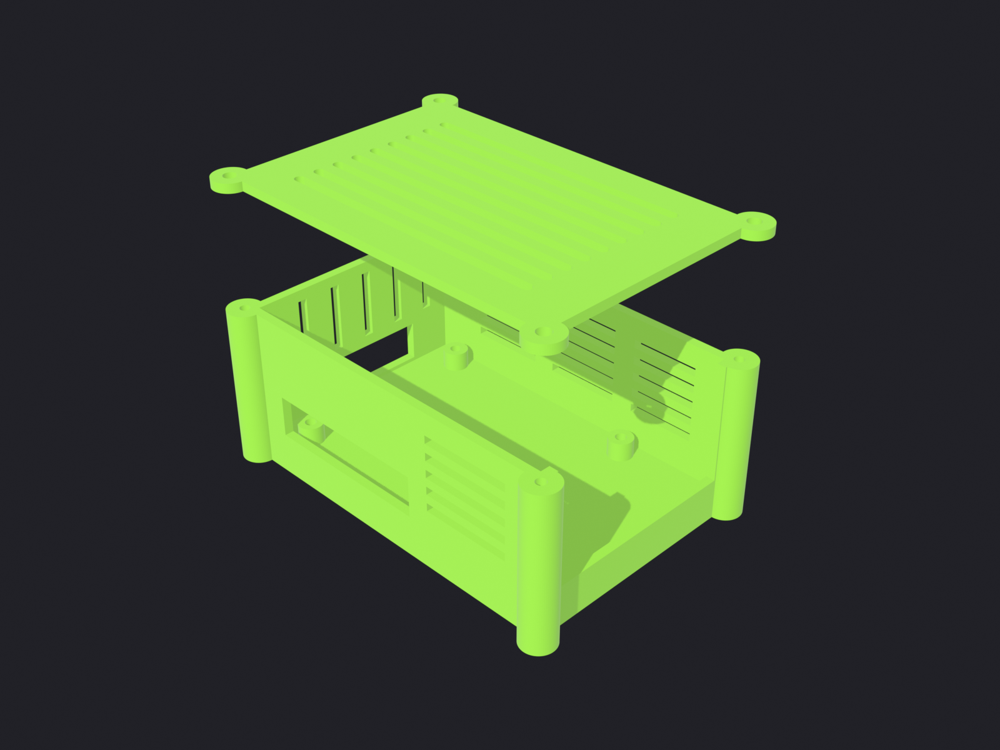

# Raspberry Pi 5 wall-mount case

A two-part printed case for a Raspberry Pi 5 with a 52Pi U2500 HAT (dual 2.5GbE + M.2 NVMe). It hangs on two wall screws by keyhole slots in the back, with the USB and Ethernet ports pointing down.

> [!WARNING]
> This design has not been test-printed. Do the fit checks in section 2 of the [assembly guide](v2/assemble.html) before you put any electronics in.



## The design

The current design is in [`v2/`](v2).

- The Pi and HAT are clamped as one stack by four screws that enter from the back of the case, pass through the Pi, and thread into the HAT's standoffs. The screw heads sit in recesses so the back stays flat against the wall.
- The lid screws into the four corner posts.
- The port end is open, and there are vent slots in the lid, both long sides, and the top end. There is no cooler in this build.
- A printed drill template marks the two wall-screw positions, which are 57 mm apart, one above the other.

[`v1/`](v1) is the earlier design, for the official Active Cooler and Raspberry Pi M.2 HAT+. It is archived and has no assembly guide.

## What you need

| | |
| --- | --- |
| **Printed parts** | `pi5_case_base.stl`, `pi5_case_lid.stl`, `pi5_drill_template.stl` |
| **Electronics** | Raspberry Pi 5, 52Pi U2500 HAT with its standoffs, screws, ribbon and USB bridge, M.2 NVMe SSD (2230 or 2242) |
| **Stack screws** | 4 × M2.5 × 16 button head socket cap |
| **Lid screws** | 4 × M3 × 10 self-tapping (thread-forming for plastic). Do not go longer than 12 mm. |
| **Wall screws** | 2 × #6 or #8 pan head (or 4 mm). The head must be no wider than 9 mm and no thicker than 3 mm. Add anchors to suit your wall. |
| **Tools** | 1.5 mm hex key, screwdriver for the M3 and wall screws, drill, pencil, spirit level, 3 mm and 5 mm drill bits for cleaning holes |

## Building it

The step-by-step instructions are in [`v2/assemble.html`](v2/assemble.html): printing, fit checks, wall mounting, assembly, and what to change if something does not fit. GitHub shows that file as source code, so download or clone the repo and open it in a browser.

## Regenerating the picture

The image above is rendered from the v2 STLs with [Blender](https://www.blender.org/):

```sh
blender -b -P v2/render.py
```

This overwrites `v2/render.png`. Run it again after the STLs change.
